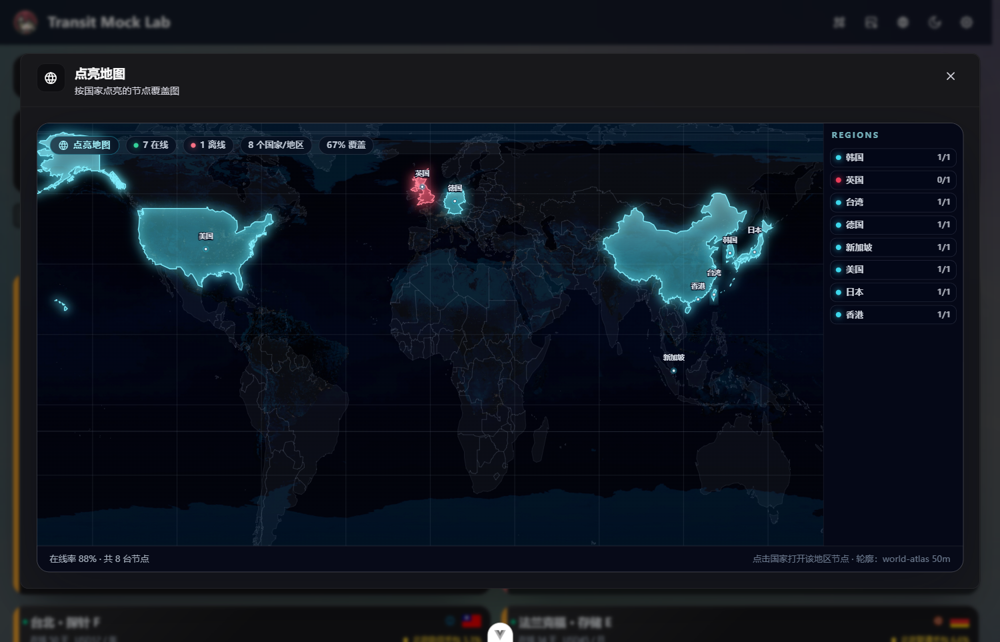

# Transit · 点亮地图版

> [Komari Monitor](https://github.com/komari-monitor/komari) 的拓扑优先运维主题，在 v1.4.5 基础上新增「国家整片点亮」的节点覆盖地图。

[](https://vuejs.org/)
[](https://vite.dev/)
[](https://tailwindcss.com/)
[](https://github.com/komari-monitor/komari)
[](komari-theme.json)
[](LICENSE)

本仓库是 [yyy622hhh/komari-theme-transit](https://github.com/yyy622hhh/komari-theme-transit) 的二次开发分支，基于 `v1.4.5`（`ee9f31c`）。上游原有的拓扑管理、三网 Ping、回程线路、智能观测面板、告警与资产视图全部保留；这一版的主要变化是**把「点亮地图」做成了按国家整片发光的覆盖图**。



<details>
<summary>上游主题原来的首页（暗色 / 亮色）</summary>

| 暗色总览                                                        | 亮色总览                                                         |
| --------------------------------------------------------------- | ---------------------------------------------------------------- |
|  |  |

</details>

---

## 目录

- [这个分支改了什么](#这个分支改了什么)
- [点亮地图怎么用](#点亮地图怎么用)
- [实现要点](#实现要点)
- [Transit 原本是什么](#transit-原本是什么)
- [快速开始](#快速开始)
- [本地开发](#本地开发)
- [校验与构建](#校验与构建)
- [目录结构](#目录结构)
- [与上游保持同步](#与上游保持同步)
- [文档导航](#文档导航)
- [致谢与许可证](#致谢与许可证)

---

## 这个分支改了什么

| 改动               | 文件                                                                                   | 说明                                                                                      |
| ------------------ | -------------------------------------------------------------------------------------- | ----------------------------------------------------------------------------------------- |
| 整片点亮的覆盖地图 | [`src/components/NodeCoverageMap.vue`](src/components/NodeCoverageMap.vue)             | 按国家轮廓填充发光，不是光点；在线率连续渐变、扫描式点亮、悬停/点击交互                   |
| 地图弹窗           | [`src/components/CoverageMapDialog.vue`](src/components/CoverageMapDialog.vue)         | 复用 `AppDialog`，异步加载，宽 `min(96vw, 84rem)`                                         |
| 工具栏入口         | [`src/components/Header.vue`](src/components/Header.vue)                               | 首页顶部新增 🌐「点亮地图」按钮，点击国家后跳转到该地区节点详情                           |
| 国家轮廓数据       | [`public/images/world/countries.paths.json`](public/images/world/countries.paths.json) | 216 个国家 / 126 KB，只在弹窗打开时加载                                                   |
| 本地 Mock 后端     | [`mock/server.mjs`](mock/server.mjs)                                                   | 8 台模拟节点，纯 Node 内置模块，不依赖 Komari 服务端                                      |
| 开发服务器稳定性   | [`vite.config.ts`](vite.config.ts)                                                     | 忽略编辑器原子写入产生的 `.*.tmpdir` 临时目录，避免 Windows 上 `EBUSY` 让 dev server 退出 |
| 上游完整文档       | [`UPSTREAM-README.md`](UPSTREAM-README.md)                                             | 原版 README（顶部附来源说明），便于查阅全部功能细节                                       |

## 点亮地图怎么用

1. 打开首页，点击右上角工具栏的 🌐 **点亮地图**。
2. 弹窗里是一张夜景地球底图：**有节点的国家整片被点亮**，其余国家只留淡灰骨架轮廓作对比。
3. 颜色按该国家的在线率连续变化：**深青 = 全部在线 → 琥珀 = 部分掉线 → 玫红 = 全部离线**。
4. 打开时从赤道向两极依次扫亮（约 1.4 秒），`prefers-reduced-motion` 下直接显示终态。
5. 悬停光点/右侧 `REGIONS` 列表看地区在线数；**点击国家**会直接跳到该地区的节点详情页；信息卡里也有「打开该地区节点」按钮。
6. 港澳节点会点亮**整个中国轮廓**（`HK` / `MO` → `CN` 映射），标签仍保留原地区名。

顶部统计条显示在线 / 离线 / 国家数 / 大洲覆盖率，底栏显示在线率与总节点数。

## 实现要点

给要继续改的人：

- **数据口径**：点亮范围来自现成的 `useNodeGeoClusters` 区域聚合，组件只做投影与渲染，不新增业务计算，保持 `Component → Composable → Service` 的分层。
- **轮廓数据**：构建期从 `world-atlas` 的 `countries-50m` TopoJSON 解码（delta / arc 自行实现，零运行时地理库依赖），做等距矩形投影（`74°N ~ 50°S`，`1440 × 720` viewBox），再经 Ramer–Douglas–Peucker 简化（容差 0.7 px）与坐标取整，把 756 KB 原始数据压成 126 KB 静态 JSON。新加坡、香港、卢森堡这类小地区在 50m 下有真实轮廓；极少数仍无几何的地区自动退化为发光圆片。
- **港澳并入中国**：`REGION_COUNTRY_ALIAS = { HK: 'CN', MO: 'CN' }`，按国家合并在线/离线台数后再上色。
- **在线率 → 颜色**：`ratePalette(rate)` 沿 HSL 色相连续插值 `187° → 45° → 350°`，填充透明度 + 共用高光渐变 + 外发光滤镜叠出「发光」质感，不是离散三档。
- **扫描点亮**：每片按聚合中心纬度算 `|lat| / 90 × 1400ms` 的动画延迟，赤道先亮、高纬后亮。
- **点击跳转**：`NodeCoverageMap → CoverageMapDialog → Header` 三级事件，最终 `router.push({ name: 'instance-detail', params: { id } })`，取该地区第一台节点的 UUID。
- **底图**：沿用仓库已有的 [`public/images/earth/earth-night.jpg`](public/images/earth/earth-night.jpg) 夜景贴图，压暗后叠暗角与经纬网格。

## Transit 原本是什么

Transit 是面向多节点、多线路和跨境链路监控的 Komari 社区主题，把「入口 → 线路机 → 可选跳板 → 落地机」的链路拓扑、三网 Ping、实时资源、异常告警和资产信息放进一套紧凑的毛玻璃界面。

| 区域     | 能力                                                                  |
| -------- | --------------------------------------------------------------------- |
| 线路状态 | 多线路拓扑、逐段实时/静态/待探测状态、健康评分、24 小时曲线与基线洞察 |
| 拓扑管理 | 内置/自定义入口、线路机、跳板与落地机；保留已绑定 ICMP/TCP 协议与目标 |
| 三网质量 | 节点卡直接展示联通 / 电信 / 移动 Ping、ICMP 丢包率与近期采样          |
| 回程线路 | 判定 CN2GIA / 163 / 9929 / CMIN2 等骨干网（可选伴生插件）             |
| 告警运维 | 异常摘要、事件时间线、线路可靠性、维护状态、健康统计与审计日志        |
| 资产视角 | 价格、剩余价值、到期日、流量配额与厂商信息                            |
| 显示     | 亮/暗/北京时间自动模式、本机壁纸、四档卡片密度与移动端布局            |

主题包本身**不修改** Komari 数据库、Agent 或系统账户；公网信息查询与访客审计默认关闭。完整功能说明、配置 key、安全边界与常见问题见 [`UPSTREAM-README.md`](UPSTREAM-README.md)。

> [!NOTE]
> 上游文档里的徽章、Release 链接与 Issue 入口指向 `yyy622hhh/komari-theme-transit`。本仓库目前**不发布 Release 附件**，安装与构建请按下面的步骤自己来。

## 快速开始

### 1. 构建主题安装包

需要 Node.js `^22.22.2 || ^24.15.0 || >=26.0.0`，或仓库声明的 **Bun 1.3.14**。

```bash
bun install --frozen-lockfile
bun run build
```

`bun run build` 会并行执行类型检查与构建，生成：

```text
dist/
komari-theme-Transit-build-<short-sha>.zip
```

ZIP 根目录固定为：

```text
komari-theme.json
preview.png
dist/
```

### 2. 装到 Komari

1. 登录 Komari 管理后台 → **主题管理** → 上传上面生成的 `komari-theme-Transit-build-*.zip`（不要上传 GitHub 自动生成的源码压缩包）。
2. 启用短名称为 `Transit` 的主题。
3. 在主题设置里选主题模式、节点卡密度、默认观测面板与三网地区。
4. 强制刷新浏览器。首页工具栏就会出现 🌐「点亮地图」。

主题短名称仍是 `Transit`，与上游同短名称的托管设置兼容；升级前建议保留上一版 zip，方便随时回滚。发布自己的版本前，记得把 [`komari-theme.json`](komari-theme.json) 里的 `url` / `author` 改成你的仓库信息。

## 本地开发

仓库自带一个纯 Node 的 Mock 后端：8 台模拟节点（含 1 台离线）、实时指标、北京三网 Ping 任务与历史采样，覆盖 `GET /api/public`、`/api/me`、`/api/version`、`/api/nodes`、`/api/recent`、`/api/records/*` 与 `POST /api/rpc2`（JSON-RPC 2.0）。**全部是本地生成的假数据，不连接任何真实服务。**

开两个终端：

```bash
# 终端 1：Mock 后端（默认 127.0.0.1:25774，可用 MOCK_PORT 改）
node mock/server.mjs

# 终端 2：Vite 开发服务器（/api 与 /themes 默认已代理到 25774）
bun run dev --port 5180
```

Windows PowerShell 里若需手动指定后端地址：

```powershell
$env:VITE_API_TARGET = "http://127.0.0.1:25774"
bun run dev --port 5180
```

打开 **http://127.0.0.1:5180/** 即可。改 `src/` 下的文件会热更新；`vite.config.ts` 已忽略 `.*.tmpdir` / `*.tmp`，避免编辑器原子写入在 Windows 上触发 `EBUSY` 把 dev server 干掉。

想换成真实 Komari 数据，把 `VITE_API_TARGET` 指向你的 Komari 面板根地址即可（例如 `https://status.example.com`）。

## 校验与构建

按仓库 [`AGENTS.md`](AGENTS.md) 的约定：

```bash
bun run lint:check      # ESLint，不自动修复
bun run type-check      # vue-tsc --build
bun run build-only      # 仅构建 dist/
bun run test:visual     # UI 改动建议跑（Playwright，需先装浏览器）
```

发布相关改动再跑：

```bash
bun run build           # 类型检查 + dist/ + zip
bun run audit:release   # 发布结构门禁
```

`test:visual` 的权威像素基准由 CI 在 macOS 上维护，本地 `tests/visual/snapshots-local/` 是 gitignored 的；**不要**用 `test:visual:baseline` 覆盖本机差异。

## 目录结构

```text
├── src/
│   ├── components/
│   │   ├── NodeCoverageMap.vue       # 点亮地图本体（本分支新增）
│   │   ├── CoverageMapDialog.vue     # 地图弹窗（本分支新增）
│   │   └── Header.vue                # 工具栏入口与跳转（本分支修改）
│   ├── composables/                  # 区域聚合等响应式逻辑
│   ├── stores/ · utils/ · services/  # 状态、请求与业务层
│   └── AGENTS.md                     # 源码树开发约定
├── public/images/
│   ├── world/countries.paths.json    # 50m 国家轮廓（本分支新增）
│   └── earth/earth-night.jpg         # 夜景地球底图
├── mock/server.mjs                   # 本地 Mock 后端（本分支新增）
├── docs/
│   ├── screenshots/                  # 文档截图
│   └── *.md                          # 架构 / 认证 / 数据流 / 兼容性 …
├── UPSTREAM-README.md                # 上游完整文档（原版 README 原样保留）
├── komari-theme.json                 # 主题清单与全部设置项（唯一版本源）
├── vite.config.ts                    # 构建、代理、分包与 ZIP 打包
└── AGENTS.md                         # 仓库级开发约定
```

## 与上游保持同步

本地已配置两个 remote：

```text
origin    → https://github.com/Mryexingyun/komari-theme-transit-change.git
upstream  → https://github.com/yyy622hhh/komari-theme-transit.git
```

```bash
git fetch upstream
git merge upstream/main          # 或 git rebase upstream/main
```

合并时重点看这几个文件：`src/components/Header.vue`（工具栏按钮）、`vite.config.ts`（watch 忽略）、以及 `public/images/` 下的资源契约。

## 文档导航

| 想看什么                             | 去哪                                                                                                                                                        |
| ------------------------------------ | ----------------------------------------------------------------------------------------------------------------------------------------------------------- |
| 本分支新增功能                       | 本页「点亮地图怎么用」「实现要点」                                                                                                                          |
| 拓扑管理器、Ping 口径、回程线路、FAQ | [`UPSTREAM-README.md`](UPSTREAM-README.md)                                                                                                                  |
| 全部主题设置 key 与默认值            | [`komari-theme.json`](komari-theme.json)                                                                                                                    |
| 架构 / 认证 / 数据流 / 缓存          | [`docs/Architecture.md`](docs/Architecture.md) · [`docs/Auth.md`](docs/Auth.md) · [`docs/DataFlow.md`](docs/DataFlow.md) · [`docs/Cache.md`](docs/Cache.md) |
| 兼容性矩阵                           | [`docs/Compatibility.md`](docs/Compatibility.md)                                                                                                            |
| 隐私与数据流                         | [`PRIVACY.md`](PRIVACY.md)                                                                                                                                  |
| 贡献流程 / 安全报告 / 变更记录       | [`CONTRIBUTING.md`](CONTRIBUTING.md) · [`SECURITY.md`](SECURITY.md) · [`CHANGELOG.md`](CHANGELOG.md)                                                        |
| 开发约定                             | [`AGENTS.md`](AGENTS.md) · [`src/AGENTS.md`](src/AGENTS.md)                                                                                                 |

## 致谢与许可证

感谢上游 [yyy622hhh/komari-theme-transit](https://github.com/yyy622hhh/komari-theme-transit) 及它致谢的项目：[Komari](https://github.com/komari-monitor/komari)、[komari-theme-Glassmorphism](https://github.com/sanrokamlan-prog/komari-theme-Glassmorphism)、[komari-theme-Glassmorphism-three-network](https://github.com/vlongx/komari-theme-Glassmorphism-three-network)。国家轮廓数据来自 [world-atlas](https://github.com/topojson/world-atlas)（ISC License）。

本仓库由 Transit 提供、且未另行标注的代码采用 [MIT License](LICENSE)。发布与再分发时请保留版权与许可证声明；上游作品的许可证不会因本分支而自动适用于第三方作品。
